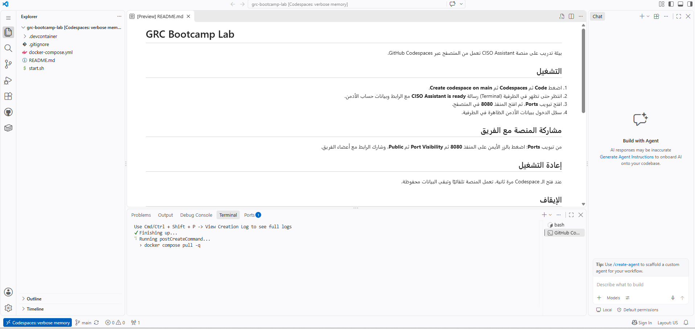
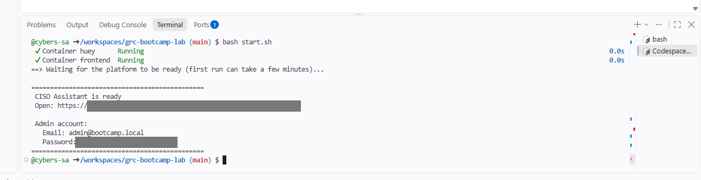
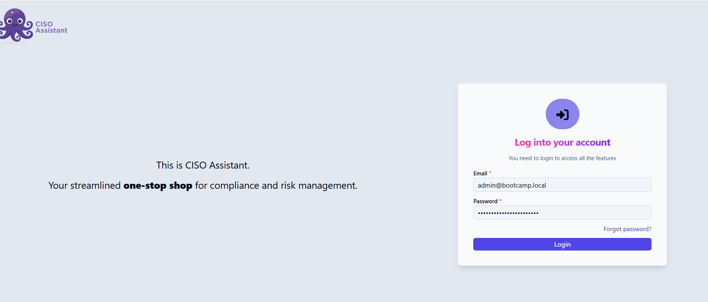
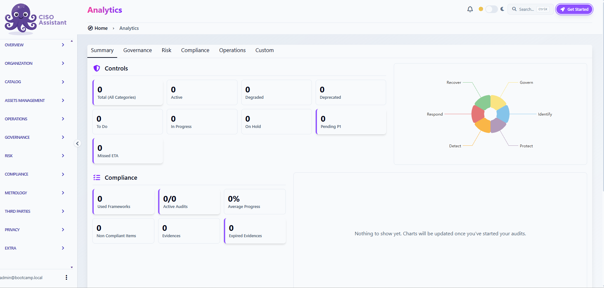
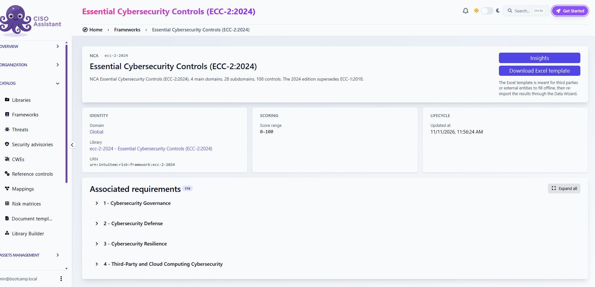

<div dir="rtl">

# مختبر GRC

بيئة تدريب جاهزة على منصة **CISO Assistant** مفتوحة المصدر لإدارة الحوكمة والمخاطر والامتثال، وفيها ضوابط الهيئة الوطنية للأمن السيبراني **ECC-2:2024** جاهزة للتحميل.

تعمل بالكامل من المتصفح عبر **GitHub Codespaces**، بدون سيرفر وبدون تثبيت أي برنامج.

📄 [تحميل الدليل بصيغة PDF](docs/GRC-Lab-Guide.pdf)

## المتطلبات

- حساب GitHub مجاني
- متصفح حديث (Chrome أو Edge)

## الخطوة 1: أنشئ الـ Codespace

1. اضغط الزر التالي:

[](https://codespaces.new/cybers-sa/grc-bootcamp-lab?hide_repo_select=true&ref=main&geo=EuropeWest&machine=basicLinux32gb)

2. تأكد من الإعدادات: **Region: Europe West** و **Machine type: 2-core**.
3. اضغط **Create codespace**.

## الخطوة 2: انتظر التجهيز

يفتح محرر في المتصفح وتحته طرفية (Terminal). أول مرة يحمّل المنصة، وتأخذ من **5 إلى 15 دقيقة**.



عند الجاهزية تظهر رسالة **CISO Assistant is ready** مع الرابط وبيانات حساب الأدمن. تُحفظ البيانات أيضًا في ملف `admin-credentials.txt`.



## الخطوة 3: ادخل المنصة

1. اضغط **Ctrl** مع النقر على الرابط الظاهر في الطرفية، أو افتح تبويب **Ports** ثم المنفذ **8080**.
2. سجّل الدخول بالإيميل وكلمة المرور.
3. غيّر كلمة المرور من زر **⋮** بجانب الإيميل أسفل القائمة.





## الخطوة 4: حمّل ضوابط ECC

1. من القائمة: **CATALOG** ← **Libraries**
2. ابحث عن **ECC** واختر **Essential Cybersecurity Controls (ECC-2:2024)**
3. اضغط زر التحميل مرة واحدة.
4. تأكد من وجوده في **CATALOG** ← **Frameworks**.



> إذا ظهرت رسالة **Failed to load library** بعد ضغطة ثانية، فالإطار محمّل من الضغطة الأولى.

## مشاركة المنصة مع الفريق

1. من تبويب **Ports**، اضغط بالزر الأيمن على المنفذ **8080**.
2. اختر **Port Visibility** ← **Public**.
3. شارك الرابط مع أعضاء الفريق، وأنشئ لكل عضو حسابًا من **ORGANIZATION** ← **Users**.

> الرابط يعمل فقط أثناء تشغيل الـ Codespace، وأي شخص لديه الرابط يصل لصفحة الدخول. استخدم بيانات تدريبية فقط.

## الإيقاف وإعادة التشغيل

- **الإيقاف:** من [github.com/codespaces](https://github.com/codespaces) اضغط **⋯** ثم **Stop codespace** بعد كل جلسة. يتوقف تلقائيًا بعد 30 دقيقة بدون استخدام.
- **إعادة التشغيل:** افتحه من نفس الصفحة، وتعمل المنصة تلقائيًا والبيانات محفوظة. إذا لم تعمل، اكتب في الطرفية:

```
bash start.sh
```

## الاستهلاك المجاني

| البند | الحساب المجاني شهريًا |
| --- | --- |
| ساعات الحوسبة | 120 ساعة، تعادل 60 ساعة تشغيل على جهاز 2-core |
| التخزين | 15 جيجا، ويُحتسب حتى لو كان الـ Codespace موقفًا |

تابع الاستهلاك من [github.com/settings/billing](https://github.com/settings/billing)، واحذف الـ Codespace بعد نهاية المعسكر.

## حل المشاكل

| المشكلة | الحل |
| --- | --- |
| رسالة `The platform did not start in time` | شغّل `bash start.sh` مرة ثانية |
| الطرفية توقفت بدون رسالة الجاهزية | شغّل `bash start.sh` |
| الصفحة لا تفتح | تأكد أن الـ Codespace يعمل، وافتح المنفذ 8080 من تبويب **Ports** |
| عرض سبب أي خطأ | `docker compose logs --tail=30 backend` |

</div>
